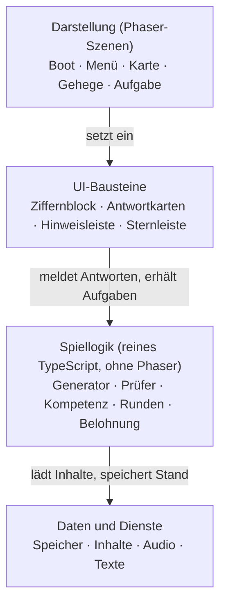

# Zahlen-Zoo: Spezifikation (Phaser, TypeScript, Vite)

Stand: 7. November 2026. Ergänzend: `kompetenzerwartungen-klasse-2.md`.

## 1. Ziel und Rahmen

Der Zahlen-Zoo ist ein Browser-Lernspiel, in dem Kinder der 2. und 3. Klasse Zootiere versorgen und dafür kurze Rechenaufgaben lösen. Version 1 deckt Klasse 2 ab, Klasse 3 folgt als Erweiterung.

| Punkt | Festlegung |
| --- | --- |
| Zielgruppe | 7 bis 9 Jahre; Klasse 2 in V1, Klasse 3 in V2 |
| Geräte | Tablets mit Touch zuerst, Laptops mit Maus zusätzlich |
| Bildschirm | Querformat, Basisauflösung 1024 × 768, skaliert auf andere Größen |
| Browser | aktuelle Versionen von Chrome, Safari, Edge und Firefox |
| Sprache | Deutsch; alle Texte in Dateien ausgelagert, weitere Sprachen später möglich |
| Spieldauer | eine Runde 5 bis 10 Minuten |
| Kosten | nur freie Software (MIT, BSD, Apache); Grafik und Audio frei lizenziert oder selbst erstellt |
| Betrieb | statische Webseite ohne Server und ohne Konto |

**Nicht-Ziele in V1:** Online-Mehrspieler, Ranglisten gegen andere Kinder, Werbung, Käufe, Tracking, Lehrer-Dashboard mit Cloud.

Querformat und die Basisauflösung 1024 × 768 sind bestätigt.

## 2. Didaktisches Konzept

Das Spiel übt Rechenstrategien statt reinem Auswendiglernen und lässt Kinder Fehler ohne Strafe erkennen. Die Inhalte folgen dem üblichen Stoff der Grundschule; Referenz ist der Lehrplan Mathematik für die Grundschulen in Nordrhein-Westfalen; der Abgleich der Inhalte mit seinen Kompetenzerwartungen steht noch aus.

Die Kompetenzerwartungen für Klasse 2 und ihre Abdeckung im Spiel stehen in der Datei `kompetenzerwartungen-klasse-2.md`.

| Bereich | Klasse 2 (V1) | Klasse 3 (V2) |
| --- | --- | --- |
| Zahlenraum | bis 100: Nachbarzahlen, Zehner und Einer, Vergleichen, Ordnen | bis 1000: Hunderter, Zehner, Einer, Runden |
| Addition und Subtraktion | bis 100, mit und ohne Zehnerübergang, Ergänzen | bis 1000, halbschriftlich, Rechenwege |
| Multiplikation und Division | Verdoppeln, Halbieren, Kernaufgaben des Einmaleins (1, 2, 5, 10) und Ableiten, Division als Verteilen | Einmaleins sicher, Division als Umkehrung, Rest |
| Sachaufgaben | einschrittige Textaufgaben mit Bild | zweischrittige Textaufgaben |
| Größen | Geld bis 100 €, Uhrzeit (volle, halbe, Viertel- und Dreiviertelstunde; analog und digital), Längen in cm und m, Brüche ¼, ½, ¾ bei Größen | Uhrzeit auf die Minute, Gewicht, Rauminhalt |
| Geometrie und Muster | Formen erkennen, Muster fortsetzen, Achsensymmetrie erkennen, Wege beschreiben, Körper erkennen | Flächen auslegen, Brüche (Hälfte, Viertel), Umfang |
| Daten und Kombinatorik | Strichlisten, Tabellen und Kalender lesen, einfache Kombinatorik | noch festzulegen (Abgleich mit einer Lehrkraft) |

**Didaktische Leitlinien**

- **Anschauung zuerst:** Zehnerfeld, Rechenstrich und Hundertertafel sind in jeder Aufgabe auf Wunsch einblendbar.
- **Fehler als Chance:** Eine falsche Antwort zeigt eine Hilfe und einen zweiten Versuch, nie ein bloßes „Falsch“.
- **Kein Zeitdruck als Standard:** Tempo-Modi sind optional und nur für Aufgaben, die das Kind schon sicher kann.
- **Mehrere Darstellungen:** Dieselbe Rechnung erscheint als Zahl, Bild und Handlung (Tiere füttern, Eimer füllen).
- **Kurze Runden:** 8 bis 12 Aufgaben pro Runde, danach ein sichtbarer Abschluss.
- **Eigener Fortschritt:** Vergleich nur mit der eigenen Bestleistung.

## 3. Technologie-Stack und Setup

Der Stack ist Phaser mit TypeScript, gebaut mit Vite. Alle Bausteine sind frei (MIT-Lizenz oder ähnlich). Vor Projektstart prüfen, welche Phaser-Hauptversion aktuell stabil ist, und die Versionen in `package.json` festschreiben.

| Zweck | Werkzeug | Anmerkung |
| --- | --- | --- |
| Spiel-Engine | Phaser | Szenen, Sprites, Tweens, Touch, Drag-and-drop, Sound |
| Sprache | TypeScript (strict) | Typen für Aufgaben, Spielstand, Inhalte |
| Build und Dev-Server | Vite | schneller Start, Hot Reload |
| Unit-Tests | Vitest | für die Spiellogik ohne Phaser |
| End-to-End-Tests | Playwright | optional, ein Durchlauf pro Aufgabentyp |
| Qualität | ESLint, Prettier | einheitlicher Stil |
| Offline und Installation | vite-plugin-pwa | Installation auf Schul-Tablets, Offline-Betrieb |
| Sound | Phaser Sound Manager | reicht aus, keine zusätzliche Bibliothek nötig |
| Texte | JSON-Dateien je Sprache | einfache eigene `t(key)`-Funktion |

**Projekt anlegen (Beispielbefehle)**

```bash
npm create vite@latest zahlen-zoo -- --template vanilla-ts
cd zahlen-zoo
npm install phaser
npm install -D vitest eslint prettier vite-plugin-pwa
```

**Skripte in `package.json`**

| Skript | Wirkung |
| --- | --- |
| `npm run dev` | Entwicklungsserver mit Hot Reload |
| `npm run build` | Produktions-Build in `dist/` |
| `npm run preview` | Build lokal ansehen |
| `npm test` | Vitest für Spiellogik |
| `npm run lint` | ESLint und Prettier-Prüfung |

**Konfigurationsentscheidungen**

- Phaser-Skalierung im Modus „FIT“ mit zentrierter Leinwand, Basis 1024 × 768.
- Alle Aufgabenansichten und Eingaben (Ziffernblock, Antwortkarten) als Phaser-Objekte; ein DOM-Overlay nur für Menüs mit Text, falls nötig.
- `strict: true` und `noUncheckedIndexedAccess` in `tsconfig.json`.
- Keine Laufzeit-Abhängigkeiten außer Phaser; Spiellogik ohne Importe aus Phaser.

## 4. Architektur und Projektstruktur

Die Spiellogik liegt getrennt von der Darstellung und kennt Phaser nicht; dadurch lässt sie sich ohne Browser testen.



Szenen zeigen an und nehmen Eingaben entgegen; nur die Logikschicht erzeugt Aufgaben, prüft Antworten und entscheidet über Fortschritt.

**Ordnerstruktur**

```text
src/
  main.ts            Start und Phaser-Konfiguration
  scenes/           BootScene, MenuScene, MapScene, AreaScene, TaskScene,
                    RoundEndScene, ParentScene, SettingsScene
  ui/               Numpad, AnswerCards, HintBar, StarMeter, Button
  logic/            kein Import aus Phaser erlaubt
    rng.ts          startwertbasierter Zufall
    generators/     add100.ts, sub100.ts, multTable.ts, clock.ts, money.ts,
                    pattern.ts, wordTask.ts
    check.ts        Antwortprüfung und errorTag
    skills.ts       Kompetenzmodell
    rounds.ts       Rundenzusammenstellung
    rewards.ts      Sterne und Freischaltung
  services/         save.ts, audio.ts, i18n.ts, content.ts
  types/            task.ts, save.ts, content.ts
public/assets/      Bilder, Audio, Schrift, Daten (siehe Abschnitt 11)
tests/              logic.*.test.ts
```

**Regeln**

- Szenen sprechen mit Diensten (`save`, `audio`, `content`) und der Logikschicht über Funktionsaufrufe und wenige Phaser-Ereignisse, etwa `answer-submitted` und `round-finished`; globale Variablen gibt es nicht.
- Eine ESLint-Regel (`no-restricted-imports`) verbietet `phaser` in `src/logic/`.
- Inhalte (Bereiche, Familien, Texte) kommen aus JSON; neue Aufgaben erfordern keinen Code in den Szenen.
- Jede Szene räumt beim Verlassen Ereignisse und Tweens auf, damit Tablets bei langen Sitzungen nicht langsamer werden.

## 5. Spielkonzept Zahlen-Zoo

Das Kind baut einen Zoo auf: Auf einer Karte wählt es einen Bereich, versorgt dort ein Tier durch gelöste Aufgaben und schaltet mit Sternen neue Tiere, Bereiche und Dekoration frei.

**Kernschleife (eine Runde, 5 bis 10 Minuten)**

1. Das Kind wählt auf der Weltkarte einen freigeschalteten Bereich.
2. Ein Tier zeigt seinen Wunsch als Aufgabe („Der Elefant braucht 3 Eimer Wasser, 4 Elefanten ...“).
3. Das Kind löst 8 bis 12 Aufgaben; jede richtige Antwort versorgt das Tier sichtbar (Futter, Wasser, Spiel).
4. Am Rundenende erscheinen 1 bis 3 Sterne und ein kurzer Rückblick (Was war leicht, was üben wir wieder?).
5. Sterne schalten Tiere, Dekoration und neue Bereiche frei; der Zoo wächst sichtbar.

**Bereiche der Weltkarte (V1: Klasse 2, V2: Klasse 3)**

| Bereich | Tier | Mathethema | Klasse |
| --- | --- | --- | --- |
| Affenwald | Affe | Zahlenraum bis 100: Nachbarzahlen, Ordnen, Zehner und Einer | 2 |
| Pinguinfelsen | Pinguin | Einspluseins bis 20 (Stufe 0), Addition und Subtraktion bis 100, Zehnerübergang, Überschlag | 2 |
| Elefantenwiese | Elefant | Verdoppeln, Halbieren, Kernaufgaben des Einmaleins (1er, 2er, 5er, 10er), Ableiten, Division als Verteilen | 2, 3 |
| Zoo-Kasse | Papagei | Geld, Wechselgeld, Sachaufgaben | 2, 3 |
| Futteruhr | Eule | Uhrzeit: volle, halbe, Viertel- und Dreiviertelstunde, analog und digital; Brüche bei Größen | 2, 3 |
| Schmetterlingshaus | Schmetterling | Muster, Achsensymmetrie erkennen, Formen | 2, 3 |
| Giraffenhof | Giraffe | Längen messen und vergleichen, Stützpunkte für 1 cm und 1 m, Brüche bei Größen; später Hunderterraum bis 1000 und Runden | 2, 3 |
| Zoo-Zählung | Erdmännchen | Strichlisten, Tabellen und Kalender lesen, einfache Kombinatorik | 2, 3 |

**Freischaltung (Startwerte, im Test anzupassen)**

- Zu Beginn offen: Affenwald und Pinguinfelsen.
- Jeder weitere Bereich öffnet, wenn im Vorgängerbereich insgesamt 6 Sterne gesammelt sind.
- Jeder Bereich hat 3 Stufen; die nächste Stufe öffnet nach einer Runde mit mindestens 2 Sternen.
- Mit Sternen kauft das Kind Tiere (Baby-Tiere des Bereichs) und Dekoration; ein Spiel-Shop mit echtem Geld existiert nicht.

**Spielmodi**

- **Pflegerunde (Standard):** ohne Zeitlimit, mit Hilfen.
- **Tempo-Runde (optional, ab Stufe 2 eines Bereichs):** Zeitbonus statt Zeitstrafe; Fehler kosten keine Sterne. In V1 ist der Modus nur angelegt (Auswahl im Menü, Zeitmessung, Feld für den Zeitbonus im Spielstand); die Ausgestaltung folgt in V2.
- **Tagesfutter:** 5 gemischte Aufgaben aus bereits geübten Bereichen, die das Kompetenzmodell zur Wiederholung auswählt.
- **Baumodus (klein):** Würfelgebäude nach Plan bauen sowie Würfel, Quader und Kugel erkennen und sortieren; kein eigener Bereich, erreichbar aus dem Gehege.

## 6. Spiellogik: Aufgaben

Jede Aufgabe entsteht aus einem Generator pro Aufgabenfamilie und einer Stufe. Generatoren und Antwortprüfung sind reines TypeScript ohne Phaser und mit festem Zufallsstartwert testbar.

Die Aufgabenfamilien mit Bezug zu den Kompetenzerwartungen der Klasse 2 stehen in der Datei `kompetenzerwartungen-klasse-2.md`.

**Aufgabenmodell**

```ts
type Task = {
  id: string;              // eindeutig pro Runde
  family: string;          // z. B. "add_100", "mult_table", "clock_half"
  level: 1 | 2 | 3;
  kind: TaskKind;          // siehe Tabelle der Aufgabentypen
  prompt: { text: string; images?: string[] };
  answer: number | number[] | string;
  options?: { value: string; errorTag?: string }[];
  hints: [Hint, Hint, Hint];   // Stufen 1 bis 3
  strategyId?: string;     // Verweis auf Visualisierung
};

type CheckResult = { correct: boolean; errorTag?: string };
```

**Aufgabentypen (Eingabeformen)**

| Typ | Eingabe | Beispiel |
| --- | --- | --- |
| `number-input` | Ziffernblock im Spiel | 47 + 26 = ? |
| `choice` | 3 bis 4 Antwortkarten antippen | Welche Zahl liegt zwischen 59 und 61? |
| `gap` | Lücke füllen | \_\_ + 30 = 70; Zahlenmauer |
| `drag-sort` | Karten ziehen und ordnen | Zahlen der Größe nach ordnen |
| `number-line` | Marker auf Zahlenstrahl setzen | Wo liegt 65? |
| `clock` | Zeiger einstellen oder Uhrzeit wählen | Stelle 7:30 Uhr ein |
| `money` | Münzen und Scheine ziehen | Lege 3,40 € |
| `pattern` | Felder im Raster anklicken | Wo liegt die Spiegelachse? |
| `word` | Bild plus Text, Eingabe oder Auswahl | 4 Elefanten brauchen je 3 Eimer ... |

**Stufen am Beispiel dreier Familien (Startwerte)**

| Familie | Stufe 1 | Stufe 2 | Stufe 3 |
| --- | --- | --- | --- |
| `add_100` | Zehner plus Einer, ohne Übergang (34 + 5, 40 + 20) | zweistellig plus einstellig mit Übergang (38 + 7) | zweistellig plus zweistellig (47 + 26) |
| `mult_table` | Kernaufgaben: Reihen 1, 2, 5, 10 | Ableiten (3 × 4 aus 2 × 4 + 4) | Umkehren und Ergänzen (\_\_ × 5 = 35) |
| `clock_half` | volle und halbe Stunden | Viertel- und Dreiviertelstunde | analog und digital, ½ Stunde = 30 Minuten |

**Regeln für die Erzeugung**

- Zufallszahlen kommen aus einem eigenen, startwertbasierten Generator (z. B. mulberry32), nie direkt aus `Math.random()`.
- Eine Aufgabe tritt in einer Runde nur einmal auf; Tauschaufgaben (3 + 5, 5 + 3) zählen als gleich.
- Ergebnisse bleiben im Zahlenraum der Stufe (Klasse 2: höchstens 100).
- Falsche Antwortkarten stammen aus typischen Fehlern: Zehnerfehler (± 10), Einerfehler (± 1), vertauschte Ziffern, vergessener Übertrag. Jede Karte trägt ein `errorTag`.
- Eine Runde mischt etwa 70 % Aufgaben der aktuellen Stufe, 20 % der Vorstufe (Sicherung), 10 % der nächsten Stufe (Herausforderung).

**Antwortprüfung**

- `check(task, input)` liefert richtig oder falsch plus `errorTag`, wenn der Fehler einem bekannten Muster entspricht.
- Mehrere gleichwertige Antworten sind erlaubt (Zerlegungen, Reihenfolge von Summanden).
- Eingaben mit führenden Nullen oder Leerzeichen werden vor der Prüfung normalisiert.

## 7. Adaptive Schwierigkeit und Fortschritt

Das Spiel schätzt pro Aufgabenfamilie, wie sicher das Kind ist, und wählt daraus Stufe und Wiederholungen. Das Modell bleibt bewusst einfach, damit es verständlich und lokal testbar ist.

**Kompetenzmodell (je Familie und Kind)**

- Gespeichert werden die letzten 10 Antworten als Liste (richtig im ersten Versuch, richtig mit Hilfe, falsch) sowie der Zeitpunkt der letzten Übung.
- Die Sicherheit ist der gewichtete Anteil richtiger Antworten: richtig im ersten Versuch zählt 1, richtig mit Hilfe 0,5, falsch 0; neuere Antworten zählen stärker.
- Antwortzeiten fließen nur ein, um sehr schnelle, sichere Antworten für Tempo-Runden zu erkennen, nie als Strafe.

**Regeln (Startwerte)**

| Situation | Folge |
| --- | --- |
| Sicherheit ≥ 0,85 in der aktuellen Stufe, mindestens 8 Antworten | Stufe steigt, Fortschrittsanzeige zeigt es |
| Sicherheit < 0,5 über die letzten 6 Antworten | Stufe sinkt um 1, mehr Visualisierung, mehr Hilfen |
| Dreimal derselbe `errorTag` in einer Runde | nächste Aufgabe erklärt die Strategie (z. B. Zehnerübergang) mit Bild |
| Familie 7 Tage nicht geübt | Familie erscheint im Tagesfutter zur Wiederholung |
| Sicherheit ≥ 0,85 und Antwortzeit unter dem eigenen Mittel | Tempo-Runde wird angeboten |

**Rundenzusammenstellung**

1. Familie und Stufe aus dem gewählten Bereich bestimmen.
2. Verhältnis 70 / 20 / 10 für aktuelle, vorherige und nächste Stufe anwenden.
3. Bei Tagesfutter: die 5 Familien mit der niedrigsten Sicherheit oder der längsten Pause wählen.
4. Aufgaben erzeugen, Duplikate verwerfen, Reihenfolge leicht ansteigend mischen (erst leichter, in der Mitte schwerer, am Ende wieder leichter).

**Fortschritt für Eltern und Lehrkräfte**

- Eine einfache Übersicht (ohne Konto, nur lokal) zeigt je Familie Sicherheit und häufigste Fehlerart.
- Sie ist über einen Erwachsenen-Knopf mit einfacher Rechenaufgabe erreichbar, damit Kinder nicht versehentlich dort landen.
- Export des Spielstands als Datei (JSON) für den Gerätewechsel.

## 8. Feedback, Hilfen und Belohnungen

Ein Fehler führt zu einer Hilfe und einem neuen Versuch, nie zu einem Verlust. Belohnungen zeigen Fortschritt und Sammelfreude, ohne Druck aufzubauen.

**Ablauf bei jeder Aufgabe**

1. Richtig im ersten Versuch: Das Tier freut sich, kurzer Ton, die Fortschrittsleiste füllt sich.
2. Falsch: freundlicher Hinweis 1 und zweiter Versuch.
3. Wieder falsch: Hinweis 2 mit Visualisierung und dritter Versuch.
4. Wieder falsch: Die Lösung wird Schritt für Schritt gezeigt; dieselbe Familie kommt später in der Runde erneut vor.

**Hilfestufen**

| Stufe | Inhalt | Beispiel (47 + 26) |
| --- | --- | --- |
| 1 | Lenkender Satz, keine Lösung | „Rechne erst die Zehner, dann die Einer.“ |
| 2 | Bild der Strategie, Kind füllt mit | Rechenstrich: 47, + 20, + 6 |
| 3 | Lösung mit Rechenweg, vorgelesen | 47 + 20 = 67; 67 + 6 = 73 |

Hinweise sind auf Wunsch jederzeit über einen Knopf abrufbar; Text wird auf Wunsch vorgelesen (Audiodatei je Hinweis).

**Sterne pro Runde (Startwerte)**

| Sterne | Bedingung |
| --- | --- |
| 1 | Runde beendet |
| 2 | mindestens 70 % der Aufgaben richtig, auch mit Hilfe |
| 3 | mindestens 90 % der Aufgaben richtig im ersten Versuch |

**Sammelobjekte**

- Tiere (Baby-Tiere je Bereich), die das Kind benennen darf.
- Dekoration für Gehege und Wege.
- Sticker-Album mit Mathe-Abzeichen („5 Aufgaben ohne Hilfe“, „Alle Reihen der 5“).

**Gestaltungsregeln gegen Druck**

- Kein Game Over, keine Leben, kein Sternverlust.
- Tiere werden bei Fehlern nie traurig oder wütend; sie ermutigen.
- Keine täglichen Serien, die verfallen, keine Mitteilungen, die zum Spielen drängen.
- Rückmeldungen loben Strategie und Durchhalten („Du hast den Zehner gut gelöst“), nicht Begabung.
- Textbausteine werden abwechselnd verwendet, damit Lob nicht leer klingt.

## 9. UI/UX und Barrierefreiheit

Die Bedienung funktioniert mit einem Finger, ohne Tastatur und ohne Lesen langer Texte. Jede Aufgabe lässt sich auch vorlesen.

**Bedienung**

- Touch zuerst: Tippflächen mindestens 64 × 64 Pixel in der Basisauflösung, Abstand mindestens 16 Pixel.
- Zahleneingabe über einen eigenen Ziffernblock (0 bis 9, Löschen, Bestätigen) im Spiel, keine Bildschirmtastatur.
- Ziehen und Ablegen mit Einrasten: Karten rasten im Zielfeld ein, wenn sie nahe genug sind; Loslassen außerhalb schickt sie sanft zurück.
- Ein-Finger-Gesten; Doppeltippen und Wischen sind nie erforderlich.
- Immer sichtbar: Zurück zur Karte, Hinweis, Vorlesen. Aktionen mit Datenverlust gibt es nicht.

**Layout**

- Obere Leiste: Bereichsname, Rundenfortschritt als Fußspuren oder Punkte.
- Mitte: Aufgabe mit Bild und Text.
- Unten: Eingabe (Ziffernblock oder Antwortkarten) und Hinweis-Knopf.
- Das Tier steht links neben der Aufgabe und reagiert auf Antworten.

**Lesbarkeit**

- Schrift: gut lesbare Grundschulschrift ohne Schnörkel, mindestens 28 px für Aufgabentext in der Basisauflösung, Ziffern größer (48 px).
- Kontrast mindestens 4,5 : 1 für Text; Information nie nur durch Farbe, sondern zusätzlich durch Form oder Symbol.
- Kurze Sätze, Wörter aus dem Grundwortschatz der 2. Klasse.

**Audio**

- Vorlesen jeder Aufgabe und jedes Hinweises über eingesprochene Audiodateien.
- Musik und Effekte getrennt regelbar; Standardlautstärke niedrig.
- Ton startet erst nach der ersten Berührung (Browser-Vorgabe).

**Barrierefreiheit**

- Hoher-Kontrast-Modus und größere Schrift als Einstellung.
- Reduzierte Bewegung: Animationen lassen sich abschalten, wenn das Betriebssystem es verlangt.
- Farbenblind-sichere Palette für alle Spielinformationen.
- Tastaturbedienung als Zusatz für Laptops (Pfeiltasten, Eingabe, Leertaste), auch wenn Touch Vorrang hat.

Da Phaser auf einer Canvas zeichnet, sind Bildschirmleser nur eingeschränkt nutzbar. Das ist eine bekannte Grenze der Engine und wird durch Vorlesen und einfache Bedienung ausgeglichen.

## 10. Daten, Speicherung und Datenschutz

Alle Daten bleiben auf dem Gerät. Das Spiel braucht kein Konto, sendet nichts an Server und setzt keine Tracker ein; damit entfallen die meisten Datenschutzpflichten für Schulen und Eltern.

**Spielstand**

- Speicherung im Browser per `localStorage` für kleine Daten (Einstellungen, Sterne) oder IndexedDB, falls die Antwortlisten größer werden.
- Mehrere Profile pro Gerät (Pflicht in V1, z. B. für Klassensatz-Tablets): ein Profil pro Kind mit Spitzname und Tierbild statt Klarnamen, Profilauswahl im Menü, Löschen je Profil.
- Versionsnummer im Spielstand und eine Migrationsfunktion pro Versionssprung.
- Export und Import als JSON-Datei, damit Fortschritt beim Gerätewechsel erhalten bleibt.

**Beispiel für den Spielstand**

```json
{
  "version": 1,
  "profile": { "nickname": "Mia", "avatar": "fox" },
  "stars": 14,
  "zoo": { "animals": ["monkey_baby_1"], "decor": ["bench_1"] },
  "skills": {
    "add_100": { "level": 2, "last": [1, 1, 0.5, 0, 1], "lastPlayed": "2026-11-07" }
  },
  "settings": { "music": 0.4, "sfx": 0.8, "readAloud": true, "largeText": false }
}
```

**Datenschutz**

- Keine Cookies außer technisch notwendigem Speicher, keine Analyse-Dienste, keine externen Schriftarten oder Skripte von Fremdservern (alles wird selbst gehostet).
- Das Spiel läuft offline, sobald es einmal geladen ist.
- Löschen: Ein Knopf im Erwachsenenbereich entfernt alle lokalen Daten.
- Die Webseite enthält ein Impressum und eine Datenschutzerklärung, im Spiel über die Fußzeile des Menüs erreichbar und offline verfügbar; die Erklärung nennt die lokale Speicherung der Spielstände. Die Anbieterangaben für das Impressum und der Datenschutztext stehen in `legal.json` und werden zur Laufzeit geladen; die konkreten Daten werden später ergänzt. Angaben und Texte vor der Veröffentlichung rechtlich prüfen lassen.
- Wird das Spiel an Schulen eingesetzt, empfiehlt sich eine Abstimmung mit der Datenschutzstelle des jeweiligen Landes.

## 11. Zu erstellende Ressourcen

Für V1 (acht Bereiche, Klasse 2) werden rund 200 Grafikdateien, 15 Soundeffekte, 3 Musikstücke, eingesprochene Hinweise und 9 JSON-Dateien benötigt. Mengen sind Planwerte und hängen vom Stil ab. Ein einheitlicher Illustrationsstil für Tiere und Karte ist wichtiger als die Menge.

**Übersicht**

| Kategorie | Umfang V1 | Format | Priorität |
| --- | --- | --- | --- |
| Weltkarte | 1 Hintergrund, 8 Bereichsmarker (je gesperrt, offen, fertig) | WebP oder PNG, 2048 × 1536 | hoch |
| Tiere | 8 Arten × 4 Zustände (ruhig, freut sich, frisst, denkt) plus 8 Baby-Varianten | Sprite-Sheets, je 4 bis 8 Bilder | hoch |
| Bereichshintergründe | 8 | WebP, 2048 × 1536 | hoch |
| Mathe-Darstellungen | Zehnerfeld, Hundertertafel, Rechenstrich, Zahlenstrahl, Zehnerstangen und Einerwürfel, Uhr, Münzen und Scheine, Muster-Kacheln, Formen | Vektor oder PNG | hoch |
| Aufgabenobjekte | Eimer, Fisch, Banane, Futternapf, Ei, Blume u. ä., rund 20 | PNG, 256 × 256 | mittel |
| UI-Elemente | Ziffernblock (0 bis 9, Löschen, OK), Antwortkarten, Knöpfe (Hinweis, Vorlesen, Zurück, Einstellungen, Erwachsenenbereich), Fortschrittsleiste, Sterne (leer, voll), Dialog | Atlas aus PNG | hoch |
| Dekoration | rund 12 Stück (Bank, Baum, Teich, Zaun ...) | PNG, Atlas | niedrig |
| Abzeichen und Sticker | rund 12 | PNG, 256 × 256 | niedrig |
| Profil-Avatare | 8 Tierbilder | PNG, 256 × 256 | mittel |
| App-Symbole | Logo, Favicon, PWA-Icons (192, 512, maskierbar) | PNG, SVG | mittel |
| Soundeffekte | richtig, sanftes Falsch, Ziffer drücken, Karte greifen und ablegen, Stern, Freischaltung, Rundenende, 8 Tierlaute | MP3 oder M4A | hoch |
| Musik | Weltkarte, Aufgabenansicht, Rundenabschluss | MP3 oder M4A, Loop | mittel |
| Gesprochene Texte | Hinweise, Standardsätze, Zahlwörter 0 bis 100 | MP3 oder M4A | mittel |
| Daten | 9 JSON-Dateien (siehe unten) | JSON | hoch |
| Schrift | 1 gut lesbare Grundschulschrift in 2 Schnitten | WOFF2, lokal eingebunden | hoch |

**Daten-Dateien (JSON)**

| Datei | Inhalt |
| --- | --- |
| `areas.json` | Bereiche, Mathethema, Familien, Freischaltschwellen |
| `families.json` | Aufgabenfamilien mit Parametern je Stufe (Zahlenräume, Regeln, Typ) |
| `animals.json` | Tiere, Namen, Sprite-Verweise, Sternpreise |
| `hints.de.json` | Hinweistexte je Familie und Stufe (drei Hilfestufen) |
| `word-templates.de.json` | Vorlagen für Sachaufgaben mit Platzhaltern (30 bis 40 Stück) |
| `strings.de.json` | alle Oberflächentexte |
| `praise.de.json` | Lob und Ermutigung, jeweils mehrere Varianten |
| `achievements.json` | Abzeichen mit Bedingungen |
| `legal.json` | Impressum (Anbieter, Anschrift, Kontakt) und Datenschutztext, zur Laufzeit geladen; Daten folgen später |

**Ablage und Benennung**

```text
public/assets/
  img/      map/  animals/  areas/  ui/  math/  objects/  decor/  badges/  icons/
  audio/    sfx/  music/  voice/
  fonts/
  data/     *.json
```

- Dateinamen kleingeschrieben mit Unterstrich: `animals/monkey_happy.webp`, `voice/hint_add_100_1.mp3`.
- Bilder zu Atlanten bündeln (Tiere, UI, Objekte), um Ladezeit und Anfragen zu sparen.
- Ziel für das gesamte Paket: unter 25 MB, damit Offline-Installation auf Schul-Tablets schnell geht.
- Audio als MP3 oder M4A, weil alle Browser beides abspielen.

**Quellen und Lizenzen**

- Tiere und Karte werden selbst erstellt, nach den vorgegebenen Größen und Stilen der Tabelle (einheitlicher Stil, klare Rechte).
- Freie Sammlungen für UI und Zusätze: Kenney.nl (CC0) für Oberflächen und Symbole; OpenGameArt.org und Freesound.org nur mit Lizenzprüfung je Datei (CC0 ist frei, CC-BY verlangt Namensnennung, Nur-nicht-kommerziell-Lizenzen vermeiden, falls das Spiel später verkauft oder beworben wird).
- Schriftkandidaten mit offener Lizenz (SIL OFL): Andika, Atkinson Hyperlegible; Zeichen `1 l I` und `0 O` im Probedruck unterscheiden.
- Eine Datei `ATTRIBUTIONS.md` führt jede fremde Datei mit Quelle, Autor, Lizenz und Link; im Spiel gibt es eine Seite „Danksagung“.
- Eurozeichen und Münzbilder stilisiert zeichnen, nicht von Fotos echter Münzen ableiten.

**Sprechertexte: Variante B mit Option auf A**

- Variante A: Alles wird von einer Person eingesprochen (beste Qualität, hoher Aufwand wegen Zahlwörtern).
- Variante B: Standardsätze eingesprochen, Zahlen und Aufgabentexte über die Sprachausgabe des Browsers (wenig Aufwand, Qualität je Gerät verschieden).
- Entscheidung: Variante B für V1. Ein Wechsel auf A bleibt möglich: Jeder Text hat einen Audio-Schlüssel; der Audio-Dienst spielt die eingesprochene Datei, falls vorhanden, sonst die Sprachausgabe des Browsers. So lassen sich Aufnahmen schrittweise nachliefern, zuerst für die Hinweise der ersten Stufe.

## 12. Qualitätssicherung und Deployment

Die Spiellogik wird automatisch getestet, die Spielbarkeit mit echten Kindern auf echten Tablets. Ausgeliefert wird eine statische Webseite.

**Automatische Tests (Vitest)**

- Generatoren: für je 1000 Startwerte liegen Ergebnis und Zwischenwerte im erlaubten Zahlenraum, falsche Antwortkarten unterscheiden sich von der Lösung und voneinander, Duplikate innerhalb einer Runde treten nicht auf.
- Antwortprüfung: richtige, falsche, äquivalente und fehlerhaft formatierte Eingaben.
- Kompetenzmodell: vorgegebene Antwortfolgen führen zu den erwarteten Stufenwechseln und Wiederholungen.
- Spielstand: Speichern, Laden, Export, Import und Migration älterer Versionen.
- Optional Playwright: je Aufgabentyp ein Durchlauf im Browser mit simulierter Touch-Eingabe.

**Manuelle Tests**

- Spieltest mit mindestens 5 Kindern der 2. Klasse, beobachtet und ohne Erklärung; notiert werden Stellen, an denen Kinder stocken.
- Inhaltliche Prüfung der Aufgaben, Hinweise und Sachaufgabentexte durch eine Lehrkraft.
- Geräteprüfung: iPad mit Safari, Android-Tablet mit Chrome, Chromebook, Laptop mit Maus.

**Akzeptanzkriterien V1**

| Kriterium | Zielwert |
| --- | --- |
| Bildrate auf einem mittleren Tablet | stabil bei 60 Bildern pro Sekunde in der Aufgabenansicht |
| Ladezeit im WLAN, erster Start | unter 5 Sekunden bis zur Weltkarte |
| Gesamtgröße der Dateien | unter 25 MB |
| Offline-Betrieb | nach dem ersten Laden vollständig spielbar |
| Fehlfreie Runde | 20 Runden pro Bereich ohne Absturz oder unlösbare Aufgabe |
| Bedienung | Kinder der 2. Klasse starten eine Runde ohne Hilfe |
| Fehlerrückmeldung | jede falsche Antwort zeigt eine Hilfe, nie nur „falsch“ |

**Deployment**

- `npm run build` erzeugt `dist/`; diese Dateien lassen sich auf jedem statischen Hosting ablegen (z. B. kostenfreie Angebote von GitHub Pages, Netlify oder Cloudflare Pages oder ein Schulserver).
- Bei Hosting unter einem Unterpfad wird `base` in `vite.config.ts` gesetzt.
- HTTPS ist Pflicht, sonst funktionieren Installation und Offline-Betrieb (Service Worker) nicht.
- Der Service Worker legt alle Dateien beim ersten Besuch ab und meldet Updates mit einem Knopf „Neue Version laden“, statt mitten in einer Runde neu zu laden.
- Eine einfache automatische Prüfung (Lint, Tests, Build) läuft bei jeder Änderung, z. B. mit GitHub Actions.

## 13. Meilensteine, Risiken und offene Fragen

Der erste Meilenstein ist ein vollständig spielbarer Bereich; erst danach wächst der Inhalt. So zeigt sich früh, ob Aufgaben, Hilfen und Bedienung bei Kindern funktionieren.

**Roadmap (5 Phasen, 4 Tore)**

1. **Fundament** (1 bis 2 Wochen): Projekt, Szenen- und Logikgerüst, Tests, automatische Prüfung.
   Tor: Eine leere Runde läuft, Tests und Build sind grün.
2. **Vertikaler Schnitt** (3 bis 4 Wochen): Ein Bereich komplett: 3 Aufgabentypen, Hilfen, Sterne, Spielstand.
   Tor: 5 Kinder spielen den Bereich ohne Hilfe von außen.
3. **Inhalte Klasse 2** (8 bis 10 Wochen): Alle 8 Bereiche, Weltkarte, Kompetenzmodell, Tagesfutter, Audio.
   Tor: Eine Lehrkraft hat Aufgaben und Hinweise geprüft.
4. **Feinschliff** (2 bis 3 Wochen): Offline-Installation, Barrierefreiheit, Erwachsenenbereich, Leistungstest.
   Tor: Akzeptanzkriterien aus Abschnitt 12 sind erfüllt.
5. **Pilot und Erweiterung** (3 bis 4 Wochen): Pilot in einer Klasse, Auswertung; danach Giraffenhof (Klasse 3) und Klasse 3.

Die Wochenangaben sind grobe Schätzungen ohne Abgleich mit der verfügbaren Zeit und verschieben sich vor allem mit dem Aufwand für Grafik und Audio.

**Risiken**

| Risiko | Folge | Gegenmaßnahme |
| --- | --- | --- |
| Grafik- und Audioaufwand größer als geplant | Verzögerung | Stil früh festlegen, Platzhalter bis Phase 3, freie UI-Grafik (z. B. CC0) nutzen |
| Aufgaben zu leicht oder zu schwer | Langeweile oder Frust | Spieltest in Phase 2, Startwerte in JSON leicht änderbar |
| Eigenheiten von Safari auf dem iPad (Ton, Vollbild, Speicher) | Fehler auf Schul-Tablets | früh auf einem iPad testen, Ton erst nach erster Berührung starten |
| Zu viel Text für Zweitklässler | Aufgabe wird nicht verstanden | Vorlesen, Bilder, kurze Sätze, Prüfung durch Lehrkraft |
| Lehrplan weicht von den Annahmen ab | Inhalte passen nicht zum Unterricht | Abgleich vor Phase 3 |
| Canvas-Darstellung schwer für Bildschirmleser | eingeschränkte Zugänglichkeit | Vorlesen und einfache Bedienung; DOM-Overlay für Menüs prüfen |

**Offene Fragen**

- [ ] Abweichungen und Lücken aus `kompetenzerwartungen-klasse-2.md` entscheiden (Giraffenhof, Zoo-Zählung, Einspluseins, Körper, Raumorientierung)
- [ ] Impressums- und Datenschutzangaben in `legal.json` eintragen (vor Veröffentlichung)
